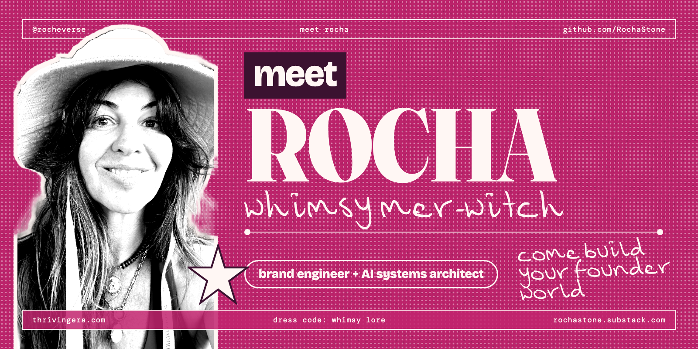
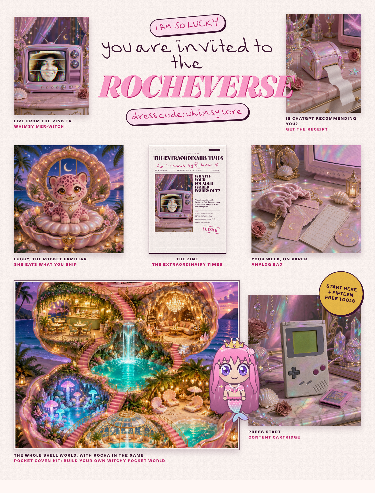

<pre align="center">
                 .   ✦        ✧          .
              ✧        ,-"""-.     .
                     ,'  ◝◜  `.    ✦
                    (   (   )   )          .
            .        `.  `-'  ,'      ✧
                       `-...-'   the shell opens
 ,=============================================================.
 |                                                             |
 |   ✦ THE EXTRAORDINAIRY TIMES FOR FOUNDERS · by Rocheverse  |
 |                                                             |
 |   Rocha (she/her) · curator and creative director           |
 |   brand engineer · ai systems architect · for female        |
 |   founders who are not engineers and never wanted to be     |
 |                                                             |
 |   ✦ building  : founder worlds, in plum and candy pink     |
 |   ✦ mood      : delulu ✧ operational                       |
 |   ✦ dress code: whimsy lore                                 |
 |                                                             |
 |   what if your founder world works out?          /\_/\     |
 |                                                 ( ◕ ✧ ◕ )   |
 |   seventeen free tools below ↓                    (  =^=  )   |
 |                                                  Lucky ♡    |
 `============================================================='
</pre>

<a href="https://instagram.com/rocheverse"><b>Instagram</b></a> ·
<a href="https://rochastone.substack.com"><b>Substack</b></a> ·
<a href="https://www.linkedin.com/in/rochellelivingstonecosmic"><b>LinkedIn</b></a> ·
<a href="https://thrivingera.com"><b>thrivingera.com</b></a> ·
<a href="https://founders.thrivingera.com"><b>Conscious Founder Operating System</b></a> ·
<a href="https://thrivingera.com/free"><b>Free tools</b></a>

---

I am Rocha. A brand engineer and AI systems architect for female founders. Come build your founder world.

I have been building and scaling brands and communities my entire career. Twenty years of brand marketing in live entertainment, multi-day festivals, the arts and high-end hospitality. Then I built the system that runs a brand. Founders around the world now run their business on an operating system I designed, in their own voice, whether or not they are at their desk. I also build the apps, booking engines, content systems and client experiences those founders need next.

The future doesn't belong to founders who become more like AI. It belongs to the ones who leverage AI to amplify more fully themselves.

New to AI? Start with Fluency, 1:1 with me. Running your own thing? Build your founder world.

This page is where I give the small things away.

<code>dress code: whimsy lore · status: delulu ✧ operational · last updated october 2026</code>

## You are invited to the Rocheverse

**Read** the lore on [Substack](https://rochastone.substack.com) · **Watch** the reels on [Instagram](https://instagram.com/rocheverse) · **Use** the free tools below and the full shelf at [thrivingera.com/free](https://thrivingera.com/free) · **Diagnose** with the [AI-native audit](https://thrivingera.com/audit) · **Install** [Conscious Founder Operating System](https://founders.thrivingera.com) · **Talk**: [book an exploratory call](https://calendly.com/rochelle-thrivingera/exploratory-call), it is where we decide if we work together.

## Rocha Coded. Free tools from the Rocheverse.

| Tool | What she gets | Runs in |
|---|---|---|
| [for-reels](https://github.com/RochaStone/for-reels) | Film one take. Your AI cuts, captions and styles the reel on your own computer. | Claude Code · Claude Cowork · Codex |
| [ai-recommends-you](https://github.com/RochaStone/ai-recommends-you) | Find out who the machines send your dream client to. Get the receipt. | Claude Code · Claude Cowork |
| [podcast-outreach-engine](https://github.com/RochaStone/podcast-outreach-engine) | Claude finds the podcasts your people listen to and drafts the pitch in your words. You press send. | Claude Code · Claude Cowork |
| [zine-machine](https://github.com/RochaStone/zine-machine) | Five posts in. A mini-zine you can print on one sheet and fold. | Claude Code · Claude Cowork |
| [analog-bag](https://github.com/RochaStone/analog-bag) | Hook tarot, a moon-phase launch calendar and a pocket week, all printable. Photograph the page and Claude reads it back. | Claude Code · Claude Cowork |
| [claude-code-for-founders](https://github.com/RochaStone/claude-code-for-founders) | Claude Code, made safe for a founder who isn't an engineer. Six pieces, install one at a time. | Claude Code |
| [pocket-familiar](https://github.com/RochaStone/pocket-familiar) | Lucky, a pink leopard with a diamond grill, lives in your status line and eats what you ship. | Claude Code |
| [pocket-coven-kit](https://github.com/RochaStone/pocket-coven-kit) | Build your own witchy pocket world. Name your coven, theme your rooms, pick your familiars and outfits, invite your people. | Claude Code builds it with you |
| [merwitch-mode](https://github.com/RochaStone/merwitch-mode) | Claude Code looks and sounds like a sacred tool. Theme, status line, witchy state words, a sound on done. | Claude Code |
| [desktop-core](https://github.com/RochaStone/desktop-core) | A link-in-bio that is a 2003 desktop. Folders are offers, sticky notes are testimonials, the clock books a call. | Any browser |
| [unplugging](https://github.com/RochaStone/unplugging) | Unplug what drains you, at the root. Her Cord Removal Ritual from Thriving in Transformational Times, then the actual list, with the "no" emails drafted. | Any computer · Claude Code · Claude Cowork |
| [desktop-altar](https://github.com/RochaStone/desktop-altar) | Turn your desktop into an altar. You decide what sits on it. Candles flicker, tonight's moon is real. | Any computer · Claude Code · Claude Cowork |
| [handset](https://github.com/RochaStone/handset) | Any newsletter becomes a playable phone page with an earned Snake. | Any browser |
| [content-cartridge](https://github.com/RochaStone/content-cartridge) | A Game Boy in the browser. Insert a cartridge, press START, get the week. | Claude Code · Claude Cowork |
| [diagnostic-quiz](https://github.com/RochaStone/diagnostic-quiz) | A scored quiz with email results and lead capture, on your own accounts, in an afternoon. | Claude Code builds it with you |
| [ig-saves-to-notion](https://github.com/RochaStone/ig-saves-to-notion) | Your Instagram saves become a searchable hook library in Notion. No keys. | Claude Code · Claude in Chrome |
| [broll-librarian](https://github.com/RochaStone/broll-librarian) | Point Claude at your camera roll. Every clip tagged for reels. | Claude Code |

Every tool is free, MIT licensed, and runs on your own computer. Nothing phones home.

They all read one `style.json`. Make it once, with your palette, your fonts, your references and the words you say a lot, and every tool wears your taste. Mine ships inside each one as the worked example, not the rule. The full shelf, including the ones that are not code, lives at [thrivingera.com/free](https://thrivingera.com/free).

## Work with me

I work with female founders who are done doing everything themselves.

- **Start with the audit.** [thrivingera.com/audit](https://thrivingera.com/audit). Sixteen questions. You find out exactly where your business is still running on you.
- **Claude AI Fluency, 1:1.** For the woman who is new to AI, or still in the job and planning her exit. Six weeks, one to one, your own tools. [Book an exploratory call](https://calendly.com/rochelle-thrivingera/exploratory-call).
- **Build your founder world.** Your voice captured once and installed as the intelligence that runs your content, sales, strategy and visibility, inside the Conscious Founder Operating System. [founders.thrivingera.com](https://founders.thrivingera.com).
- **Builds.** Apps, booking engines, member areas, content systems and client experiences, designed and shipped for the founders I work with.
- **Book an exploratory call.** [calendly.com/rochelle-thrivingera/exploratory-call](https://calendly.com/rochelle-thrivingera/exploratory-call). It is where we decide if we work together.

## Read and watch

- [ROCHEVERSE on Substack](https://rochastone.substack.com), the newsletter.
- [Everyone I know is falling apart](https://rochastone.substack.com/p/everyone-i-know-is-falling-apart), the one to start with.
- **My books**, on [Amazon](https://www.amazon.com/stores/author/B0DXVZN7Y2):
  - [*Brand Alchemy in the Thriving Era: How Conscious Founders Channel Frequency into Business, Story, and Impact*](https://www.amazon.com/dp/B0FT4TQKP3). The book that became an operating system.
  - [*Thriving in Transformational Times: A Friendly Guide to Uplift and Shift Through Apocalyptic Changes and the Beginning of a New Era*](https://www.amazon.com/dp/B0DXNR3BNJ).
  - [*Whimsy Lore of Rocheverse*](https://www.amazon.com/dp/B0GYM6RLB7), the colouring books. Dress code: whimsy lore.
- [Free guidance for 111 female founders](https://thrivingera.com/111-women-guidance).

Sign my guestbook: [say hi in the issues](https://github.com/RochaStone/RochaStone/issues). Last updated: October 2026. Mood: delulu ✧

## Dress code: whimsy lore

Rocha \
Brand Alchemist & AI Architect \
Author of *Brand Alchemy in the Thriving Era* and *Thriving in Transformational Times* \
Creator of [Conscious Founder Operating System](https://founders.thrivingera.com) \
Founder, [Thriving Era Studio](https://thrivingera.com)

[Instagram @rocheverse](https://instagram.com/rocheverse) · [Substack](https://rochastone.substack.com) · [LinkedIn](https://www.linkedin.com/in/rochellelivingstonecosmic)
